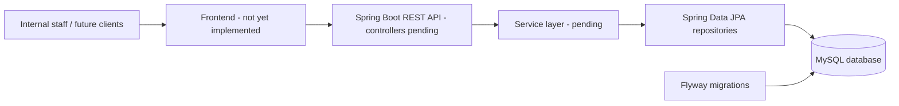
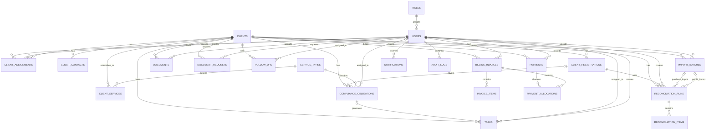

<div align="center">

# GSTFlow
### GST Practice Management System

**A Java and Spring Boot foundation for centralizing GST practice operations, client records, compliance workflows, reconciliation, and billing.**

[](https://www.oracle.com/java/technologies/javase/jdk17-archive-downloads.html)
[](https://spring.io/projects/spring-boot)
[](https://www.mysql.com/)
[](https://flywaydb.org/)
[](#project-status)

</div>

<a id="project-status"></a>

> [!WARNING]
> **GSTFlow is currently an in-development backend foundation, not a production-ready application.**
> The repository contains Spring Boot configuration, JPA entities, Spring Data repositories, a MySQL/Flyway schema, and repository tests. REST controllers, services, authentication flows, a frontend, and user-facing workflows are not yet implemented.

## Table of Contents

- [1. Project Title and Overview](#1-project-title-and-overview)
- [2. Project Banner](#2-project-banner)
- [3. Key Features](#3-key-features)
- [4. Business Problem](#4-business-problem)
- [5. Solution](#5-solution)
- [6. Technology Stack](#6-technology-stack)
- [7. System Architecture](#7-system-architecture)
- [8. Application Modules](#8-application-modules)
- [9. Database Design](#9-database-design)
- [10. Entity Relationship Diagram](#10-entity-relationship-diagram)
- [11. Project Structure](#11-project-structure)
- [12. API Documentation](#12-api-documentation)
- [13. Installation and Setup](#13-installation-and-setup)
- [14. Database Configuration](#14-database-configuration)
- [15. Running the Application](#15-running-the-application)
- [16. Environment Variables](#16-environment-variables)
- [17. Testing](#17-testing)
- [18. Security Considerations](#18-security-considerations)
- [19. Screenshots](#19-screenshots)
- [20. Future Enhancements](#20-future-enhancements)
- [21. Contribution Guidelines](#21-contribution-guidelines)
- [22. Author](#22-author)
- [23. License](#23-license)

## 1. Project Title and Overview

**GSTFlow – GST Practice Management System** is a web application being designed for GST consultants, chartered accountants, tax professionals, accounting firms, and internal office staff.

The intended platform will replace fragmented Excel registers and follow-up messages with a centralized system for client records, multiple GST registrations, compliance obligations, staff assignments, documents, reconciliation, billing, payments, and reporting.

The initial target scope is approximately **200–500 clients and six internal users**.

## 2. Project Banner

The banner above is a concise text-and-badge project header. A visual product banner or logo has not been added to the repository.

## 3. Key Features

### Implemented in the codebase

- JPA domain model for clients, users, roles, registrations, services, assignments, obligations, tasks, documents, reconciliation, billing, payments, notifications, and audit logs
- Spring Data JPA repositories for persistence operations
- Repository queries for client search, GSTIN lookup, assigned tasks, overdue obligations, and unread notifications
- Pagination support on applicable repository methods
- MySQL schema creation through a Flyway migration
- Hibernate schema validation configuration
- H2-based repository test setup
- Spring Actuator dependency
- Spring Security dependency
- Maven wrapper for consistent build commands

### In development

- REST API controller and service layers
- Authentication and user login
- Role-based authorization
- End-to-end client and staff management workflows
- Compliance tracking interfaces
- Document upload and storage
- Billing and reconciliation workflows
- Dashboard and reporting
- Notification delivery
- Frontend application

### Planned

- GSTR-1 and GSTR-3B workflow automation
- ITC and GSTR-2B reconciliation processing
- GST registration, ITR, TDS, e-way bill, and e-invoice tracking
- Follow-up automation
- PDF reports and invoices
- External GST portal/GSP integration
- Full audit and notification services
- Client self-service and WhatsApp/email integrations

## 4. Business Problem

GST practices commonly maintain client information in spreadsheets, distribute work through messages, and track deadlines in disconnected files. This makes it difficult to:

- Identify upcoming or overdue compliance obligations
- Assign work consistently across staff
- Maintain a complete history for each client
- Store and verify documents centrally
- Reconcile purchase records with portal data
- Track invoices, payments, and outstanding balances
- Produce reliable management reports

## 5. Solution

GSTFlow is designed as a centralized operational system with a modular domain model. The backend foundation already represents core practice-management relationships and repositories that can support future controllers and services.

The planned workflow separates:

1. Client records and GST registrations
2. Client services and staff assignments
3. Compliance obligations and tasks
4. Document requests and document metadata
5. Follow-ups and notifications
6. Import batches and reconciliation runs
7. Invoices, payments, and allocations
8. Audit events and reporting

## 6. Technology Stack

### Implemented

| Area | Technology | Evidence |
|---|---|---|
| Language | Java 17 | `pom.xml` |
| Framework | Spring Boot 4.2.0 | `pom.xml` |
| Persistence | Spring Data JPA / Hibernate | JPA entities and repositories |
| Database | MySQL | MySQL JDBC configuration |
| Schema migration | Flyway | Flyway dependency and `V1__create_gstflow_tables.sql` |
| Security dependency | Spring Security | Maven dependency; no security configuration yet |
| Validation dependency | Jakarta/Spring Validation | Maven dependency |
| Web dependency | Spring Web MVC | Maven dependency |
| Operations | Spring Actuator | Maven dependency |
| Boilerplate reduction | Lombok | Maven annotation processing |
| Build | Maven / Maven Wrapper | `pom.xml`, `mvnw`, `mvnw.cmd` |
| Tests | JUnit 5, Spring Boot test starters, H2 | Maven test dependencies and test classes |

### Not present or not configured

The following are **not currently verified** in this repository:

- Angular or another frontend framework
- Spring MVC REST controllers
- Application service classes
- Swagger / OpenAPI
- RabbitMQ
- Docker or Docker Compose
- Mockito explicitly
- CI/CD workflow
- JWT or an authentication implementation

## 7. System Architecture

The intended architecture is a **modular monolith**: one Spring Boot application organized around related business domains, with persistence shared through a relational database.



The current executable application starts through `GstHubApplication`, while database access is represented by JPA entities and Spring Data repositories. Controller and service layers should be added before HTTP APIs can be exposed.

## 8. Application Modules

| Module | Status | Evidence / intended scope |
|---|---|---|
| Client Management | Domain foundation implemented | `Client`, contacts, search repository methods |
| Multiple GST Registrations | Domain foundation implemented | `ClientRegistration`, GSTIN lookup |
| Staff and User Management | Domain foundation implemented | `User`, `Role`, user repository |
| Role-Based Access Control | Planned | Role entity exists; no authorization rules |
| GST Compliance Tracking | Domain foundation implemented | `ComplianceObligation` and repository queries |
| GSTR-1 and GSTR-3B tracking | Planned / not implemented | Service types can represent forms; no dedicated workflow |
| ITC Reconciliation | Domain foundation implemented | Import, reconciliation run, and item entities |
| GST Registration Management | Domain foundation implemented | Registration entity and repository |
| ITR and TDS Tracking | Planned | No dedicated entities/workflows in schema |
| E-way Bill and E-invoice Tracking | Planned | No dedicated entities/workflows in schema |
| Task Management | Domain foundation implemented | `Task` entity and assignment/status queries |
| Client Follow-ups | Domain foundation implemented | `FollowUp` entity and repository |
| Document Management | Domain foundation implemented | `Document` and `DocumentRequest` entities |
| Invoice and Billing Management | Domain foundation implemented | Invoice and item entities/repositories |
| Payment Tracking | Domain foundation implemented | Payment and allocation entities/repositories |
| Dashboard and Reports | Planned | No controller/report implementation |
| Audit Logging | Domain foundation implemented | `AuditLog` entity and repository |
| Notifications | Domain foundation implemented | `Notification` entity and unread query |

## 9. Database Design

One Flyway migration, `V1__create_gstflow_tables.sql`, defines the relational schema. Hibernate is configured with `ddl-auto=validate`, so entity mappings must remain compatible with migration-created tables.

Primary table groups:

### Identity and configuration
- `roles` — roles assigned to users
- `users` — staff/internal application users
- `service_types` — reusable tax services, including values such as GSTR-1 or GSTR-3B

### Client operations
- `clients`
- `client_contacts`
- `client_registrations`
- `client_services`
- `client_assignments`

### Compliance and work management
- `compliance_obligations`
- `tasks`
- `follow_ups`
- `documents`
- `document_requests`

### Imports and reconciliation
- `import_batches`
- `reconciliation_runs`
- `reconciliation_items`

### Billing
- `billing_invoices`
- `invoice_items`
- `payments`
- `payment_allocations`

### Cross-cutting records
- `notifications`
- `audit_logs`

Important relationships include:

- One role has many users
- One client has many contacts, registrations, services, assignments, obligations, tasks, documents, follow-ups, reconciliation runs, invoices, and payments
- Users can create assignments/tasks/invoices and receive notifications or undertake work
- Reconciliation runs link to two optional import batches
- Invoice items belong to one invoice
- Payment allocations connect payments to invoices

## 10. Entity Relationship Diagram



## 11. Project Structure

```text
GSTHub/
├── .mvn/wrapper/                 # Maven Wrapper configuration
├── src/
│   ├── main/
│   │   ├── java/com/example/GSTHub/
│   │   │   ├── GstHubApplication.java
│   │   │   ├── Model/            # JPA entities for the GSTFlow domain
│   │   │   └── Repository/       # Spring Data JPA repositories
│   │   └── resources/
│   │       ├── application.properties
│   │       └── db/migration/
│   │           └── V1__create_gstflow_tables.sql
│   └── test/java/com/example/GSTHub/
│       ├── GstHubApplicationTests.java
│       └── repository/RepositoryLayerTest.java
├── mvnw
├── mvnw.cmd
├── pom.xml
├── LICENSE
└── README.md
```

## 12. API Documentation

### Current status

**No REST controllers or HTTP endpoint mappings are present.** Therefore, authentication, users, clients, registrations, tasks, compliance, documents, follow-ups, reconciliation, billing, and report endpoints are **not yet available** and should not be considered implemented.

The intended future API modules are:

| Module | Planned responsibility | Current status |
|---|---|---|
| Authentication | Login, logout, token/session management | Upcoming |
| Users | Staff CRUD and activation | Upcoming |
| Clients | Client CRUD and search | Upcoming |
| Registrations | Multiple GST registration management | Upcoming |
| Tasks | Task assignment and lifecycle | Upcoming |
| Compliance | Obligation and filing-status tracking | Upcoming |
| Documents | Upload, request, and verification | Upcoming |
| Follow-ups | Scheduling and outcome tracking | Upcoming |
| Reconciliation | Import and reconciliation runs | Upcoming |
| Billing | Invoices and payment allocations | Upcoming |
| Reports | Dashboard and management reports | Upcoming |

Swagger / OpenAPI is not configured, so no generated API specification is currently available.

## 13. Installation and Setup

### Prerequisites

- Windows 10/11 or another supported development environment
- Java 17 JDK
- Maven 3.9+ or the included Maven Wrapper
- MySQL 8.x recommended
- Git
- Optional: IDE such as IntelliJ IDEA or VS Code

### 1. Install Java 17

Install a Java 17 JDK and verify:

```powershell
java -version
```

Set `JAVA_HOME` to the JDK installation directory and add `%JAVA_HOME%\bin` to `PATH`.

### 2. Clone the repository

```powershell
git clone https://github.com/Thushar7/GSTHub.git
cd GSTHub
git switch master
```

### 3. Install and start MySQL

Start MySQL Server and use MySQL Workbench or `mysql` CLI to create the database:

```sql
CREATE DATABASE gstflow_db
  CHARACTER SET utf8mb4
  COLLATE utf8mb4_unicode_ci;
```

### 4. Configure application properties

The repository currently contains local database values. Do not reuse sample credentials in production. Prefer environment variables or an external local profile.

Example:

```properties
spring.datasource.url=jdbc:mysql://localhost:3306/gstflow_db?useSSL=false&serverTimezone=Asia/Kolkata&allowPublicKeyRetrieval=true
spring.datasource.username=${DB_USERNAME}
spring.datasource.password=${DB_PASSWORD}
```

### 5. Build the project

Windows:

```powershell
.\mvnw.cmd clean compile
```

Maven installed directly:

```powershell
mvn clean compile
```

### 6. Frontend setup

No frontend project is currently included, so there is no Angular or npm setup to run.

## 14. Database Configuration

Configured settings in `src/main/resources/application.properties`:

- Server port: `8080`
- JDBC URL: `jdbc:mysql://localhost:3306/gstflow_db`
- Hibernate dialect: `MySQLDialect`
- Hibernate DDL mode: `validate`
- Flyway: enabled
- SQL logging: enabled

Before startup, the database user needs privileges to access `gstflow_db` and execute the migration. Flyway creates the schema objects from `V1__create_gstflow_tables.sql`.

For local development, replace checked-in credentials with environment variables rather than committing real secrets:

```powershell
$env:DB_USERNAME="<database-user>"
$env:DB_PASSWORD="<database-password>"
.\mvnw.cmd spring-boot:run
```

## 15. Running the Application

Windows:

```powershell
.\mvnw.cmd spring-boot:run
```

Alternatively:

```powershell
.\mvnw.cmd clean package
java -jar target\GSTHub-0.0.1-SNAPSHOT.jar
```

The application is configured to listen on:

```text
http://localhost:8080
```

A public business UI or REST endpoint is not yet implemented.

## 16. Environment Variables

No application-specific environment-variable binding is currently coded. Suggested future bindings are:

| Variable | Purpose | Status |
|---|---|---|
| `DB_USERNAME` | MySQL username | Recommended setup variable |
| `DB_PASSWORD` | MySQL password | Recommended setup variable |
| `JWT_SECRET` | JWT signing key | Planned; JWT not implemented |
| `FILE_STORAGE_ROOT` | Secure document storage location | Planned |
| `RABBITMQ_HOST` | Message broker host | Planned; RabbitMQ not implemented |

Do not commit real passwords or private keys to Git.

## 17. Testing

The repository includes:

- `GstHubApplicationTests` — basic Spring context load test
- `RepositoryLayerTest` — H2-backed repository tests for users, clients, registrations, tasks, overdue obligations, and unread notifications

Run all tests:

```powershell
.\mvnw.cmd test
```

Package without tests:

```powershell
.\mvnw.cmd clean package -DskipTests
```

Planned test coverage should include unit tests for services, controller integration tests, Flyway/MySQL compatibility tests, authorization tests, and end-to-end workflows.

## 18. Security Considerations

### Implemented only to the dependency/schema level

- Spring Security is included as a Maven dependency.
- The `users.password_hash` column is designed to store a password digest, not a plaintext password.
- A role relationship exists for users.
- Audit log entity and table structures exist for recording future actions.

### Not yet implemented

- Authentication endpoints or login flow
- BCrypt password hashing
- JWT or session configuration
- Method-level or request-level authorization
- Role enforcement
- Secure document upload/storage
- HTTPS/TLS configuration
- CSRF strategy for a deployed application
- Secret externalization from `application.properties`
- Per-user audit-log recording

Until these controls are implemented, the application should be treated as a development backend and should not be exposed to untrusted networks or production data.

## 19. Screenshots

Screenshots are not available because no frontend or UI has been committed.

Place final screenshots here after implementation:

```text


```

## 20. Future Enhancements

- Client self-service portal
- WhatsApp Business API integration
- Email reminders and scheduled notifications
- Authorized GST portal/GSP integration
- Automated recurring GSTR-1/GSTR-3B obligation generation
- Dedicated ITR and TDS workflow modules
- E-way bill and e-invoice tracking
- Advanced ITC and GSTR-2B reconciliation reports
- PDF reports and invoices
- Document storage with signed URLs and malware checks
- Docker-based local and deployment environments
- Cloud deployment, backups, and monitoring
- OpenAPI/Swagger documentation
- Messaging-based asynchronous notifications using RabbitMQ, if required

All items in this section are planned unless explicitly added to a future implementation.

## 21. Contribution Guidelines

Contributions should follow a backend-first, domain-safe workflow:

1. Fork the repository.
2. Create a focused feature branch from `master`.
3. Keep changes aligned with existing package names and entity conventions.
4. Add or update Flyway migrations instead of changing schema through ad-hoc SQL.
5. Keep Hibernate entity mappings consistent with migration constraints.
6. Add JUnit 5 and repository/service/controller tests for new behavior.
7. Do not commit database passwords, API keys, customer data, or private JWT secrets.
8. Document public REST endpoints and configuration changes in the README.
9. Open a pull request with the problem, implementation, test evidence, and migration impact.

## 22. Author

**Thushar**  
GitHub: [@Thushar7](https://github.com/Thushar7)

## 23. License

The repository currently includes an **all rights reserved** license. Use, copying, modification, distribution, publication, sublicensing, and sale are explicitly prohibited without written permission from the copyright holder.

See [`LICENSE`](LICENSE) for full terms.
