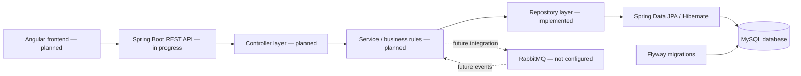
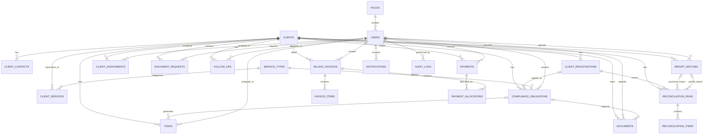

# GSTFlow — GST Practice Management System

<p align="center">
  <strong>A modular GST operations platform for consultants, chartered accountants, tax professionals, and accounting firms.</strong>
</p>

<p align="center">
  <a href="https://github.com/Thushar7/GSTHub"></a>
  
  
  
  
</p>

> **Project status:** In active development. This repository currently provides a Spring Boot backend foundation with a complete domain model, JPA repositories, MySQL/Flyway configuration, and repository-level tests. REST controllers, services, authentication, frontend UI, and end-user workflows are still being implemented.

## Table of Contents

- [Project Title and Overview](#project-title-and-overview)
- [Project Banner](#project-banner)
- [Key Features](#key-features)
- [Business Problem](#business-problem)
- [Solution](#solution)
- [Technology Stack](#technology-stack)
- [System Architecture](#system-architecture)
- [Application Modules](#application-modules)
- [Database Design](#database-design)
- [Entity Relationship Diagram](#entity-relationship-diagram)
- [Project Structure](#project-structure)
- [API Documentation](#api-documentation)
- [Installation and Setup](#installation-and-setup)
- [Database Configuration](#database-configuration)
- [Running the Application](#running-the-application)
- [Environment Variables](#environment-variables)
- [Testing](#testing)
- [Security Considerations](#security-considerations)
- [Screenshots](#screenshots)
- [Future Enhancements](#future-enhancements)
- [Contribution Guidelines](#contribution-guidelines)
- [Author](#author)
- [License](#license)

## Project Title and Overview

**GSTFlow** is a backend-in-progress web platform for digitizing GST practice operations. It is intended to centralize client records, GST registrations, compliance obligations, staff assignments, documents, reconciliation data, billing, follow-ups, notifications, and audit activity.

The project is designed for GST consultants, chartered accountants, tax professionals, accounting firms, and internal office teams, with an initial target scale of approximately 200–500 clients and six internal users.

### Repository naming

The public repository name is **GSTHub** (`Thushar7/GSTHub`), while the product name is **GSTFlow**.

## Project Banner

<!-- Replace this placeholder when a polished project banner is available. -->

<p align="center">
  
</p>

> No project banner currently exists in the repository. The image path and banner are placeholders only.

## Key Features

### Implemented in the current codebase

- JPA domain model for clients, registrations, contacts, services, and assignments
- Role and internal user persistence model
- Compliance obligation model with filing periods, due dates, review state, and acknowledgement fields
- Task persistence and assignment queries
- Document and document-request records
- Follow-up scheduling model
- Import batch model for reconciliation and document-processing inputs
- Reconciliation runs and line-level reconciliation items
- Invoice, invoice-item, payment, and payment-allocation records
- User notifications
- Audit-log records
- Flyway-managed MySQL schema
- Repository query methods for users, clients, registrations, tasks, obligations, and unread notifications
- Spring context and H2 repository tests

### Currently in development

- REST controller and API layer
- Service-layer business rules and DTO validation
- Authentication and role-based authorization
- Dashboard and reporting APIs
- GSTR-1 and GSTR-3B workflow behavior
- ITC and GSTR-2B reconciliation processing
- Document upload and secure storage
- Billing and payment workflows
- Notification delivery and reminder scheduling
- Frontend application

### Planned

- Client self-service portal
- GST portal/GSP integration
- WhatsApp Business API integration
- Email reminders
- Automated recurring compliance generation
- PDF reports and invoices
- Docker-based deployment
- Cloud deployment
- Expanded test coverage and CI/CD

## Business Problem

GST practice teams commonly manage client information across spreadsheets and maintain follow-ups through disconnected chats or personal reminders. This can lead to:

- Missed filing deadlines
- Limited visibility into staff workloads
- Duplicate or inconsistent client records
- Difficult reconciliation of purchase and GST portal data
- Weak traceability for documents and approvals
- Manual billing and payment tracking
- No centralized audit trail

## Solution

GSTFlow is designed to provide a single operational backend for GST service workflows. The domain model records the relationships between clients, registrations, assigned staff, compliance obligations, supporting documents, reconciliation runs, invoices, payments, follow-ups, notifications, and audit events.

At the current stage, the repository establishes the persistence and data-management foundation. The application is not yet a complete usable web product.

## Technology Stack

| Category | Implemented technology | Status |
|---|---|---|
| Language | Java 17 | Implemented |
| Framework | Spring Boot 4.2.0 | Implemented |
| Persistence | Spring Data JPA / Hibernate | Implemented |
| Database | MySQL | Implemented |
| Schema migration | Flyway with `flyway-mysql` | Implemented |
| Validation | Spring Validation | Dependency configured |
| Security | Spring Security | Dependency configured; application authentication/authorization not implemented |
| Web | Spring Web MVC | Dependency configured |
| Monitoring | Spring Boot Actuator | Dependency configured |
| Build | Maven Wrapper | Implemented |
| Testing | JUnit 5 support, Spring Test, H2 | Implemented foundation |
| Boilerplate reduction | Lombok | Implemented dependency |

### Not detected

The repository does **not** currently contain Angular or another frontend configuration, RabbitMQ configuration, Docker files, OpenAPI/Swagger configuration, or a service and controller layer.

## System Architecture

The intended architecture is a modular monolith rather than microservices.



### Request flow

```text
HTTP request
  -> REST controller (planned)
  -> DTO validation (planned)
  -> service business logic (planned)
  -> Spring Data repository (implemented)
  -> MySQL through JPA/Hibernate (implemented)
```

## Application Modules

| Module | Current implementation | Status |
|---|---|---|
| Client Management | Client entity, contacts, and repository | In progress |
| Multiple GST Registrations | Registration entity and repository | In progress |
| Staff and User Management | User entity, role relation, repository | In progress |
| Role-Based Access Control | Role entity in data model; no authorization rules | Planned/infrastructure in progress |
| GST Compliance Tracking | Compliance obligation entity and repository | In progress |
| GSTR-1 and GSTR-3B Tracking | Represented by service/obligation fields | Planned workflow |
| ITC Reconciliation | Import, reconciliation run, and item entities | In progress |
| GST Registration Management | Registration entity and repository | In progress |
| ITR and TDS Tracking | No dedicated implementation yet | Planned |
| E-way Bill and E-invoice Tracking | No dedicated implementation yet | Planned |
| Task Management | Task entity and repository | In progress |
| Client Follow-ups | Follow-up entity and repository | In progress |
| Document Management | Document/request entities and repository | In progress |
| Invoice and Billing Management | Invoice and item entities/repositories | In progress |
| Payment Tracking | Payment and allocation entities/repositories | In progress |
| Dashboard and Reports | No implementation | Planned |
| Audit Logging | Audit log entity/repository | In progress |
| Notifications | Notification entity/repository and unread query | In progress |

## Database Design

The initial Flyway migration creates the following tables:

| Table | Purpose |
|---|---|
| `roles` | Application role names |
| `service_types` | Configurable GST and tax service definitions |
| `clients` | Primary client/business records |
| `users` | Internal staff accounts and role assignment |
| `client_contacts` | Additional client contact people |
| `client_registrations` | GSTIN and GST registration details |
| `client_services` | Services assigned to a client |
| `client_assignments` | Internal staff assignments to clients |
| `compliance_obligations` | Filing periods, due dates, review, and acknowledgement status |
| `tasks` | Internal work items associated with clients and obligations |
| `documents` | Uploaded-document metadata and verification status |
| `document_requests` | Requested supporting documents |
| `follow_ups` | Client communication scheduling and outcomes |
| `import_batches` | Purchase/GSTR-2B and other imports |
| `reconciliation_runs` | Reconciliation operations |
| `reconciliation_items` | Invoice-level reconciliation results |
| `billing_invoices` | Client billing headers |
| `invoice_items` | Invoice line items |
| `payments` | Received payments |
| `payment_allocations` | Mapping of payments to invoices |
| `notifications` | User notifications |
| `audit_logs` | Administrative and operational audit records |

## Entity Relationship Diagram



## Project Structure

```text
GSTHub/
├── .mvn/wrapper/                 # Maven Wrapper configuration
├── src/
│   ├── main/
│   │   ├── java/com/example/GSTHub/
│   │   │   ├── GstHubApplication.java
│   │   │   ├── Model/            # JPA entities and domain relationships
│   │   │   └── Repository/       # Spring Data JPA repositories
│   │   └── resources/
│   │       ├── application.properties
│   │       └── db/migration/
│   │           └── V1__create_gstflow_tables.sql
│   └── test/java/com/example/GSTHub/
│       ├── GstHubApplicationTests.java
│       └── repository/
│           └── RepositoryLayerTest.java
├── mvnw
├── mvnw.cmd
├── pom.xml
└── README.md
```

## API Documentation

> **Current status:** No REST controllers or API endpoints are implemented. The endpoint groups below describe the planned application surface and must not be treated as currently available routes.

### Planned endpoint groups

| Module | Intended API scope | Status |
|---|---|---|
| Authentication | Login, token/session lifecycle, logout | Upcoming |
| Users | Staff creation and account management | Upcoming |
| Clients | Client CRUD and contacts | Upcoming |
| Registrations | GST registration CRUD | Upcoming |
| Tasks | Assignment, status, and completion APIs | Upcoming |
| Compliance | Obligation, GSTR-1, and GSTR-3B workflows | Upcoming |
| Documents | Upload, download, verification, and requests | Upcoming |
| Follow-ups | Scheduling and outcome tracking | Upcoming |
| Reconciliation | Import, reconciliation runs, and reports | Upcoming |
| Billing | Invoices, line items, payments, allocations | Upcoming |
| Reports | Dashboard and operational reports | Upcoming |

There is no Swagger/OpenAPI dependency or configuration in the current POM. API documentation will be added with the controller implementation.

## Installation and Setup

### Prerequisites

- Windows 10/11
- Java 17 JDK
- MySQL 8 or a compatible MySQL server
- Git
- Internet access for Maven dependencies

### 1. Install Java 17

Verify the installation:

```bat
java -version
```

Set `JAVA_HOME` to the JDK 17 installation directory if Maven does not discover Java automatically.

### 2. Install and verify Git

```bat
git --version
```

### 3. Clone the repository

```bat
git clone https://github.com/Thushar7/GSTHub.git
cd GSTHub
```

### 4. Create the MySQL database

Open MySQL Workbench or the MySQL command-line client and run:

```sql
CREATE DATABASE gstflow_db;
```

### 5. Configure the application

The repository contains local database values in `application.properties`. Do not commit real credentials. For local development, copy or override the values using environment variables or JVM arguments.

Use placeholders:

```properties
spring.datasource.url=jdbc:mysql://localhost:3306/gstflow_db?useSSL=false&serverTimezone=Asia/Kolkata&allowPublicKeyRetrieval=true
spring.datasource.username=${DB_USERNAME}
spring.datasource.password=${DB_PASSWORD}
```

## Database Configuration

The application uses:

- Hibernate schema validation: `spring.jpa.hibernate.ddl-auto=validate`
- SQL logging enabled in the checked-in development configuration
- Flyway enabled
- One initial migration: `V1__create_gstflow_tables.sql`
- MySQL dialect configuration

Ensure the database exists before startup because Flyway executes the migration before the application reaches normal operation.

For a fresh development database:

```sql
DROP DATABASE IF EXISTS gstflow_db;
CREATE DATABASE gstflow_db;
```

Do not run `DROP DATABASE` in shared or production environments.

## Running the Application

Use the Maven Wrapper so a separately installed Maven executable is not required.

### Windows

```bat
mvnw.cmd clean spring-boot:run
```

### Linux or macOS

```bash
chmod +x mvnw
./mvnw clean spring-boot:run
```

The checked-in server port is `8080`:

```text
http://localhost:8080
```

There are currently no controllers, so this address will not expose application APIs yet.

### Build a JAR

```bat
mvnw.cmd clean package
java -jar target\GSTHub-0.0.1-SNAPSHOT.jar
```

## Environment Variables

Spring property placeholders can be supplied in Windows Command Prompt:

```bat
set DB_USERNAME=<database-username>
set DB_PASSWORD=<database-password>
mvnw.cmd spring-boot:run
```

PowerShell:

```powershell
$env:DB_USERNAME="<database-username>"
$env:DB_PASSWORD="<database-password>"
.\mvnw.cmd spring-boot:run
```

Recommended variables for future development:

| Variable | Purpose |
|---|---|
| `DB_USERNAME` | MySQL username |
| `DB_PASSWORD` | MySQL password |
| `JWT_SECRET` | Planned JWT signing secret |
| `DOC_STORAGE_ROOT` | Planned document storage location |
| `NOTIFICATION_PROVIDER_KEY` | Planned notification provider credential |

These variables are documented as future requirements unless the application source explicitly uses them. Do not commit credentials or secrets.

## Testing

Run the current test suite:

```bat
mvnw.cmd test
```

The repository currently includes:

- `GstHubApplicationTests` — Spring context test class
- `RepositoryLayerTest` — H2-backed repository tests for:
  - user lookup by email
  - client lookup by client code
  - GSTIN lookup
  - tasks assigned to a user
  - overdue compliance obligations
  - unread notifications

Repository tests disable Flyway and use Hibernate `create-drop` against H2. This is an appropriate test-layer separation for the current persistence foundation, but end-to-end API, service, security, and integration coverage remains planned.

## Security Considerations

### Current implementation

- Spring Security is included as a dependency.
- Roles are represented in the persistence model.
- Password storage has a `password_hash` field.
- Audit logs can associate actions with a user and include IP address and JSON details.
- MySQL credentials should not be committed to source control.

### Implemented vs. not implemented

Spring Security being present does **not** yet provide authentication or authorization behavior for REST APIs. In the current repository:

- No JWT or session login implementation is present.
- No BCrypt password-hashing implementation is present.
- No backend role checks or access-control rules are present.
- No authentication controller or security configuration class is present.
- No secure document-storage implementation is present.
- HTTPS configuration is deployment-specific and not implemented.

### Planned security improvements

- BCrypt password hashing
- JWT or secure session authentication
- Role-based endpoint authorization
- Method-level authorization where appropriate
- Tenant/client data isolation
- Secure document storage and signed download URLs
- Environment-based secrets
- HTTPS in deployed environments
- Audit logging on security-sensitive operations
- Input validation and rate limiting
- Dependency and vulnerability scanning

## Screenshots

> No screenshots or UI assets are currently available.

### Planned screenshots

Place screenshots here once the frontend and dashboard exist:

- Dashboard overview
- Client profile and GST registrations
- Compliance calendar
- Task board
- Reconciliation workspace
- Invoice and payment tracking
- User and role management

## Future Enhancements

- [ ] REST controllers and service-layer modules
- [ ] Angular frontend
- [ ] JWT or session-based authentication
- [ ] Role-based access control
- [ ] GSTR-1 and GSTR-3B workflows
- [ ] ITR and TDS tracking
- [ ] E-way Bill and E-invoice tracking
- [ ] Automated recurring compliance obligations
- [ ] GSTR-2B/ITC reconciliation processing
- [ ] Advanced reconciliation reports
- [ ] Secure document upload and storage
- [ ] Email reminder delivery
- [ ] WhatsApp Business API integration
- [ ] Authorised GST portal/GSP integration
- [ ] PDF reports and invoices
- [ ] Dashboard and analytics
- [ ] RabbitMQ event processing
- [ ] Docker and Docker Compose setup
- [ ] Cloud deployment and CI/CD
- [ ] Swagger/OpenAPI documentation
- [ ] Broader unit, integration, and API testing
- [ ] Client self-service portal

## Contribution Guidelines

Contributions are welcome as the project transitions from backend foundation to a complete application.

1. Fork the repository.
2. Create a descriptive feature branch:

```bat
git checkout -b feature/module-name
```

3. Make focused changes and add tests for persistence or business behavior.
4. Run all tests before committing:

```bat
mvnw.cmd test
```

5. Commit clearly:

```bat
git add .
git commit -m "Add client service repository workflow"
```

6. Push and open a pull request.

Please avoid committing local database passwords, secrets, generated build output, or IDE-specific files.

## Author

**Thushar7**

- GitHub: [@Thushar7](https://github.com/Thushar7)
- Repository: [Thushar7/GSTHub](https://github.com/Thushar7/GSTHub)

## License

No license is currently included in the repository. A license should be added before public commercial or production distribution.
