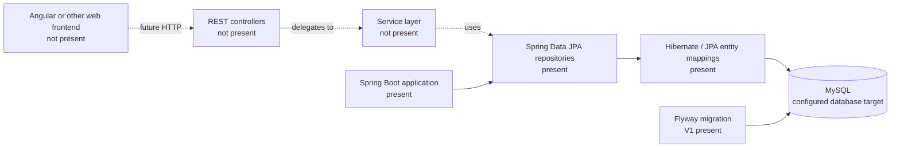
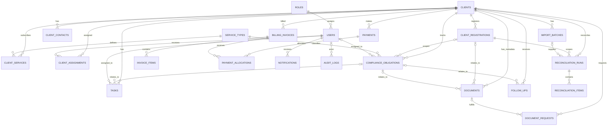

<div align="center">

# GSTFlow
### GST Practice Management System

**A backend foundation for organizing client records, GST compliance work, staff assignments, reconciliation, and billing.**

[](https://www.oracle.com/java/technologies/javase/jdk17-archive-downloads.html)
[](https://spring.io/projects/spring-boot)
[](https://maven.apache.org/)

</div>

> **Project status: in development.** The repository currently provides a Spring Boot application bootstrap, JPA domain model, Spring Data repositories, a MySQL Flyway schema migration, and repository tests. It does not yet contain REST controllers, service-layer workflows, or a frontend. A data model is groundwork—not a finished, user-facing feature.

## Table of Contents

- [Project Banner](#project-banner)
- [Key Features](#key-features)
- [Business Problem](#business-problem)
- [Solution](#solution)
- [Technology Stack](#technology-stack)
- [System Architecture](#system-architecture)
- [Application Modules](#application-modules)
- [Database Design](#database-design)
- [Entity Relationship Diagram](#entity-relationship-diagram)
- [Project Structure](#project-structure)
- [API Documentation](#api-documentation)
- [Installation and Setup](#installation-and-setup)
- [Database Configuration](#database-configuration)
- [Running the Application](#running-the-application)
- [Environment Variables](#environment-variables)
- [Testing](#testing)
- [Security Considerations](#security-considerations)
- [Screenshots](#screenshots)
- [Future Enhancements](#future-enhancements)
- [Contribution Guidelines](#contribution-guidelines)
- [Author](#author)
- [License](#license)

## Project Banner

No banner image is present in the repository yet.

<!-- Replace this placeholder with a real, repository-hosted banner when one is available. -->

> **GSTFlow — GST Practice Management System** *(project banner coming soon)*

## Key Features

### Implemented foundation

- Java 17 / Spring Boot application entry point.
- JPA entities for users, roles, clients, GST registrations, assignments, compliance obligations, tasks, documents, follow-ups, reconciliation, billing, payments, notifications, and audit records.
- Spring Data JPA repositories, including query methods for assigned tasks, overdue tasks and obligations, and unread notifications.
- A Flyway V1 migration defining the relational database schema.
- Repository-layer tests using an H2 in-memory database.

### Not yet implemented end-to-end

The repository does not currently include controllers, application services, authentication flows, or a web client. Features described below as data-model foundations should not be interpreted as available production workflows.

## Business Problem

GST consultants, chartered accountants, tax professionals, and accounting teams often coordinate client details, filing deadlines, supporting documents, staff work, and payments using disconnected spreadsheets, messaging, email, and accounting tools. Dispersed information can make follow-ups and workload visibility harder to manage.

GSTFlow is intended to provide a centralized practice-management foundation for these activities. Its initial target use case is a practice with roughly **200–500 clients and six internal users**; this is a product goal, not a measured capacity or performance claim.

## Solution

GSTFlow is being developed as a single Spring Boot application backed by a relational database. Its domain model connects clients and registrations to services, obligations, tasks, documents, reconciliation records, invoices, and payments. The current repository establishes persistence groundwork; the application workflows and user experience remain under development.

## Technology Stack

| Technology | Repository evidence / status |
|---|---|
| Java 17 | Configured in `pom.xml` |
| Spring Boot 4.2.0 | Maven parent version |
| Spring Web MVC | Dependency configured; no REST controllers yet |
| Spring Data JPA / Hibernate | JPA entities and Spring Data repositories; Hibernate is the configured JPA provider/dialect |
| Spring Security | Dependency configured; no authentication or authorization flow found |
| Spring Validation | Dependency configured; no controller request-validation flow found |
| Spring Boot Actuator | Dependency configured |
| MySQL | Runtime driver, application configuration, and MySQL-specific migration |
| Flyway | Migration dependency and `V1__create_gstflow_tables.sql` |
| Maven | Build system; Maven Wrapper scripts are checked in |
| Lombok | Used by entity classes |
| JUnit 5 / AssertJ | Test dependencies and repository test assertions |
| H2 | In-memory test database |

**Not configured/found:** Angular or another frontend, RabbitMQ, Mockito, Swagger/OpenAPI, and Docker. These should not be considered part of the current stack.

## System Architecture

GSTFlow is structured as a **modular monolith**, not a microservices system. The diagram distinguishes existing persistence/bootstrap components from application layers and clients that are not present yet.



RabbitMQ is not configured. The current codebase contains the application bootstrap, entity mappings, repositories, migration, and tests; it does not yet contain a controller or service layer.

## Application Modules

Statuses reflect checked-in evidence, not the broader product vision.

| Module | Current status | What is present |
|---|---|---|
| Client Management | **Data model** | Client and client-contact entities, migration tables, and client repository |
| Multiple GST Registrations | **Data model** | Client registrations linked to clients; GSTIN uniqueness in the schema |
| Staff and User Management | **Data model** | User and role entities and repositories; no management API/UI |
| Role-Based Access Control | **Partial foundation** | User-to-role relation and Spring Security dependency; no authorization rules or login flow found |
| GST Compliance Tracking | **Data model + repository queries** | Obligations, due dates, statuses, assignments, and overdue/filter repository queries |
| GSTR-1 and GSTR-3B tracking | **Generic groundwork only** | Generic service/obligation model; no filing-specific workflow or API |
| ITC Reconciliation | **Data model** | Import batches, reconciliation runs, and reconciliation items; no processing workflow/API |
| GST Registration Management | **Data model** | Registration records and status fields; no management workflow/API |
| ITR and TDS Tracking | **Not implemented** | No ITR/TDS domain model or workflow found |
| E-way Bill and E-invoice Tracking | **Not implemented** | No corresponding model or workflow found |
| Task Management | **Data model + repository queries** | Task assignment, status, priority, due date, and overdue/filtered queries |
| Client Follow-ups | **Data model** | Follow-up date, channel, reason, outcome, and next-follow-up fields |
| Document Management | **Metadata model** | Document metadata and storage key; upload/download and storage implementation not found |
| Invoice and Billing Management | **Data model** | Billing invoices and invoice items |
| Payment Tracking | **Data model** | Payments and invoice allocations |
| Dashboard and Reports | **Not implemented** | No dashboard/report API or frontend found |
| Audit Logging | **Data model** | Audit-log entity and table; automatic event capture not found |
| Notifications | **Data model + repository query** | User notifications and unread-notification query; no delivery mechanism found |

**Overall:** these product capabilities are in development. “Data model” means persistence structures exist; it does not mean users can operate the capability today.

## Database Design

The initial Flyway migration is `src/main/resources/db/migration/V1__create_gstflow_tables.sql`. It defines these tables:

| Area | Tables |
|---|---|
| Identity | `roles`, `users` |
| Clients and services | `clients`, `client_contacts`, `client_registrations`, `service_types`, `client_services`, `client_assignments` |
| Compliance and work | `compliance_obligations`, `tasks`, `follow_ups` |
| Documents | `documents`, `document_requests` |
| Imports and reconciliation | `import_batches`, `reconciliation_runs`, `reconciliation_items` |
| Billing and payments | `billing_invoices`, `invoice_items`, `payments`, `payment_allocations` |
| Supporting records | `notifications`, `audit_logs` |

Foreign keys in the migration define the relationships represented below. Optional links (for example, an obligation's registration or a task's obligation) are nullable in the schema. `spring.jpa.hibernate.ddl-auto=validate` is configured, so Flyway owns schema creation and Hibernate validates entity mappings against it.

## Entity Relationship Diagram

The following diagram summarizes relationships verified in the V1 SQL migration. It omits some secondary user references to keep the overview readable.



## Project Structure

```text
.
├── .mvn/wrapper/                         # Maven Wrapper configuration
├── mvnw                                  # Maven Wrapper (Unix-like systems)
├── mvnw.cmd                              # Maven Wrapper (Windows)
├── pom.xml                               # Spring Boot dependencies and build configuration
└── src
    ├── main
    │   ├── java/com/example/GSTHub
    │   │   ├── GstHubApplication.java    # Spring Boot entry point
    │   │   ├── Model/                    # JPA entities
    │   │   └── Repository/               # Spring Data repositories
    │   └── resources
    │       ├── application.properties
    │       └── db/migration/             # Flyway SQL migrations
    └── test/java/com/example/GSTHub
        ├── GstHubApplicationTests.java
        └── repository/                   # Repository-layer tests
```

There are no frontend source files, REST controller package, service package, or Docker configuration in the inspected repository.

## API Documentation

**API documentation is upcoming.** No REST controller classes or Swagger/OpenAPI configuration are present, so there are no verified HTTP routes to list. Spring Data repository methods are persistence operations, not public REST endpoints.

Authentication, Users, Clients, Registrations, Tasks, Compliance, Documents, Follow-ups, Reconciliation, Billing, and Reports are planned API areas—not currently available endpoint groups.

## Installation and Setup

### Prerequisites

- JDK 17
- MySQL Server compatible with the MySQL driver and migration SQL
- Git
- PowerShell or Command Prompt on Windows

The checked-in Maven Wrapper means a separate Maven installation is not required for the commands below.

### 1. Clone the repository

```powershell
git clone https://github.com/Thushar7/GSTHub.git
cd GSTHub
```

### 2. Install and verify Java

Install a JDK 17 distribution, set `JAVA_HOME`, and add `%JAVA_HOME%\bin` to `PATH`.

```powershell
java -version
```

### 3. Create a database

Start MySQL, then create the local development database:

```sql
CREATE DATABASE gstflow_db CHARACTER SET utf8mb4 COLLATE utf8mb4_unicode_ci;
```

### 4. Configure database access

Set local credentials as described in [Database Configuration](#database-configuration). Do not commit credentials or use development credentials in a deployed environment.

### 5. Build and test

```powershell
.\mvnw.cmd clean test
```

### Frontend setup

No frontend application is present in this repository, so frontend installation and run steps are not applicable yet.

## Database Configuration

`src/main/resources/application.properties` sets the MySQL connection, driver, Hibernate validation, SQL logging, and Flyway options. The checked-in properties file currently contains literal local database credentials; replace or override these for local use and remove inline credentials before deployment. **Never publish real credentials.**

Spring Boot supports overriding configuration through environment variables. For the current PowerShell session, configure the database connection like this (replace the placeholders):

```powershell
$env:SPRING_DATASOURCE_URL = "jdbc:mysql://localhost:3306/gstflow_db?serverTimezone=Asia/Kolkata"
$env:SPRING_DATASOURCE_USERNAME = "<your-local-mysql-user>"
$env:SPRING_DATASOURCE_PASSWORD = "<your-local-mysql-password>"
```

The application uses `spring.jpa.hibernate.ddl-auto=validate` and enables Flyway. Flyway applies migrations from `src/main/resources/db/migration/`; Hibernate then validates the mappings.

## Running the Application

From the repository root in PowerShell:

```powershell
.\mvnw.cmd spring-boot:run
```

The configured server port is `8080`. Package the application with:

```powershell
.\mvnw.cmd clean package
```

No application REST routes or user-facing frontend are present yet; successful startup is not evidence that the planned GSTFlow workflows are available.

## Environment Variables

The checked-in properties file does not declare `${...}` placeholders. Spring Boot can still bind the standard environment-variable names below and use them to override properties; configure them in your shell or deployment environment rather than storing secrets in source control.

| Variable | Purpose | Example (placeholder) |
|---|---|---|
| `SPRING_DATASOURCE_URL` | JDBC URL | `jdbc:mysql://localhost:3306/gstflow_db` |
| `SPRING_DATASOURCE_USERNAME` | Database user | `<database-user>` |
| `SPRING_DATASOURCE_PASSWORD` | Database password | `<database-password>` |

Do not put real passwords, API keys, JWT secrets, or private credentials in README files, screenshots, commits, or issue reports.

## Testing

Run tests on Windows:

```powershell
.\mvnw.cmd test
```

The repository includes an application context test and repository-layer tests for lookups and queries involving users, clients, registrations, tasks, overdue obligations, and unread notifications. Repository tests use H2, disable Flyway for that test slice, and rely on Hibernate schema generation. The repository does not claim API, end-to-end, frontend, or security test coverage.

## Security Considerations

### Current state

- Spring Security is a configured dependency, but no authentication flow, security configuration, password encoder, JWT implementation, or backend authorization rules were found.
- User records contain a `password_hash` field and are related to a role. A field and relationship alone do not implement password hashing or role-based access enforcement.
- The checked-in `application.properties` contains literal local database credential values. Replace them with secure external configuration and do not use them in deployed environments.
- Document records include a storage key and metadata, but secure file storage and access control were not found.
- An audit-log table/entity exists, but automatic audit-event capture was not found.

**Do not use the current codebase with real client, tax, or financial data until authentication, authorization, secret management, and secure document handling have been implemented and reviewed.**

### Security work to implement

- Add a tested authentication flow and a password encoder such as BCrypt.
- Enforce role-based authorization in backend endpoints.
- Externalize credentials and other secrets for each environment.
- Use HTTPS in deployed environments.
- Implement access-controlled document storage and upload validation.
- Record and test audit events for sensitive operations.

These are recommendations, not implemented features.

## Screenshots

No application screenshots are available because a frontend is not present yet. Add genuine captures when a usable UI exists; do not present mockups as completed functionality.

<!-- Future screenshots: client workspace, compliance calendar, task queue, reconciliation view. -->

## Future Enhancements

The following are planned possibilities and are **not implemented in the current repository**:

- REST controllers and service-layer workflows for the modeled domains.
- Web client, potentially using Angular.
- Client self-service portal.
- WhatsApp Business API integration and email reminders.
- Authorized GST portal / GSP integration.
- Automated recurring compliance generation and filing-specific GSTR-1 / GSTR-3B workflows.
- ITC reconciliation processing and advanced reconciliation reports.
- ITR, TDS, e-way bill, and e-invoice tracking.
- Secure document upload, storage, and retrieval.
- Dashboard, PDF reports, and PDF invoices.
- Docker-based development/deployment and cloud deployment.
- Authentication, backend authorization, and operational audit logging.

RabbitMQ is not currently configured; it should be considered only if a concrete asynchronous processing requirement arises.

## Contribution Guidelines

Contributions are welcome as the project develops. Before opening a pull request:

1. Open an issue to describe the proposed change and its scope.
2. Keep changes focused and avoid mixing unrelated work.
3. Add or update tests for behavioral changes.
4. Run `.mvnw.cmd test` on Windows (or `./mvnw test` on Unix-like systems).
5. Do not commit credentials, private client data, generated files, or secrets.
6. Update this README when setup steps, schema, dependencies, or implemented capabilities change.

Include a clear summary, motivation, and test results in your pull request. The repository has a custom, restrictive license; obtain the copyright holder's permission before contributing or reusing code.

## Author

**Thushar7** — [GitHub profile](https://github.com/Thushar7)

## License

Copyright (c) 2026 Thushar7. All rights reserved.

The repository's `LICENSE` file grants no permission to copy, modify, distribute, publish, or otherwise use the software without prior written permission from the copyright holder. This is a custom restrictive license, not an open-source license grant.
