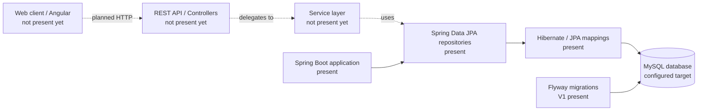
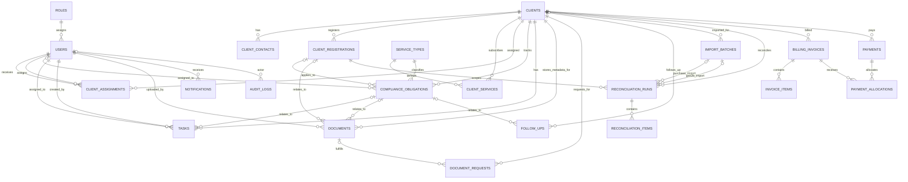

# GSTFlow – GST Practice Management System

> **Project status:** Backend foundation / in development. This repository currently contains a Spring Boot application entry point, JPA domain model, Spring Data repositories, a MySQL Flyway schema, and repository-layer tests. It does not yet contain REST controllers, service classes, an Angular frontend, or an implemented end-user workflow.

GSTFlow is a planned web-based GST and tax practice management system for GST consultants, chartered accountants, tax professionals, accounting firms, and internal office staff. Its goal is to bring client records, compliance work, documents, staff assignments, reconciliation, and billing into one system instead of relying on separate spreadsheets and informal follow-ups.

The initial product is intended for practices with approximately 200–500 clients and a small internal team. This is a target use case, not a measured or validated performance claim.

## Project Banner

No project banner is currently present in the repository. Add one here when available:

<!-- Replace this placeholder with a real, repository-hosted banner image. -->
`[Project banner — coming soon]`

## Table of Contents

- [Key Features](#key-features)
- [Business Problem](#business-problem)
- [Solution](#solution)
- [Technology Stack](#technology-stack)
- [System Architecture](#system-architecture)
- [Application Modules](#application-modules)
- [Database Design](#database-design)
- [Entity Relationship Diagram](#entity-relationship-diagram)
- [Project Structure](#project-structure)
- [API Documentation](#api-documentation)
- [Installation and Setup](#installation-and-setup)
- [Database Configuration](#database-configuration)
- [Running the Application](#running-the-application)
- [Environment Variables](#environment-variables)
- [Testing](#testing)
- [Security Considerations](#security-considerations)
- [Screenshots](#screenshots)
- [Future Enhancements](#future-enhancements)
- [Contribution Guidelines](#contribution-guidelines)
- [Author](#author)
- [License](#license)

## Key Features

The current codebase establishes backend data and persistence foundations. A schema or entity is not, by itself, a complete user-facing feature; the status below distinguishes implemented foundations from workflows that are not present yet.

### Present in the repository

- Java 17 / Spring Boot application bootstrap
- JPA entities for users, roles, clients, GST registrations, assignments, compliance obligations, tasks, documents, follow-ups, reconciliation, billing, payments, notifications, and audit records
- Spring Data JPA repositories, including query methods for assigned tasks, overdue tasks, compliance obligations, and unread notifications
- Flyway V1 migration defining the relational schema
- Repository-layer tests using an H2 database
- Spring Security dependency configured in Maven (no application security policy or authentication flow was found)

### Not implemented as end-to-end workflows yet

There are no REST controllers or service-layer classes in the repository tree, and there is no frontend. Accordingly, the entities and schema for a module should be treated as backend groundwork, not evidence that the full feature is available to users.

## Business Problem

GST practices commonly coordinate client information, deadlines, supporting documents, and staff work across spreadsheets, email, messaging applications, and separate accounting tools. This can make it harder to maintain a shared view of obligations, ownership, outstanding documents, reconciliation status, and client billing.

GSTFlow is being developed to provide a centralized foundation for those practice-management activities. The repository does not claim that it currently replaces these existing tools in a production environment.

## Solution

The project is structured as a single Spring Boot application backed by a relational database. Its domain model links clients and GST registrations to service types, compliance obligations, tasks, documents, follow-ups, reconciliation records, invoices, and payments. User and role entities support a future staff access model. REST endpoints and a web client can be added as the application evolves.

## Technology Stack

### Configured / used in the current repository

| Technology | Usage |
|---|---|
| Java 17 | Application language and configured Maven compiler version |
| Spring Boot 4.2.0 | Application framework and dependency management parent declared in `pom.xml` |
| Spring Web MVC | Web starter dependency; no REST controllers are present yet |
| Spring Data JPA / Hibernate | Persistence mappings and repository interfaces |
| Spring Security | Dependency is configured; authentication and authorization behavior are not implemented in the inspected source |
| Spring Validation | Starter dependency configured; request DTO/controller validation is not yet visible |
| Spring Actuator | Starter dependency configured |
| MySQL Connector/J | Runtime database driver |
| MySQL | Database target, confirmed by JDBC configuration and Flyway SQL migration |
| Flyway | Database migration dependency and V1 schema migration |
| Maven | Build system; Maven Wrapper scripts are included |
| Lombok | Used by model classes for getters, setters, and constructors |
| JUnit 5 and AssertJ | Test dependencies and repository-layer assertions |
| H2 | In-memory database dependency for repository tests |

### Not found as configured technologies

No Angular project files, RabbitMQ dependency/configuration, Mockito dependency, Swagger/OpenAPI dependency, or Docker files were found in the repository tree inspected for this README. Do not assume these are part of the current application.

## System Architecture

GSTFlow is intended to remain a **modular monolith**, not a microservices system. The diagram distinguishes the checked-in backend foundation (solid nodes) from application layers and clients that are not present yet (dashed nodes).



The checked-in code establishes the application bootstrap, persistence model, repository layer, and schema migration. No separate frontend, REST controller layer, or service layer is currently included. RabbitMQ is not configured.

## Application Modules

Statuses below refer to evidence in this repository, not to the broader product vision.

| Module | Current status | Repository evidence / scope |
|---|---|---|
| Client Management | **Data model present** | Client profile and contact entities, client repository |
| Multiple GST Registrations | **Data model present** | Registrations are related to a client; each GSTIN is unique in the schema |
| Staff and User Management | **Data model present** | User and role entities, plus user repository; no user-management API or UI |
| Role-Based Access Control | **Partial foundation only** | Role relation and Spring Security dependency exist; no authorization rules or login flow found |
| GST Compliance Tracking | **Data model and repository queries present** | Compliance obligations include service, period, due date, status, and assignee; overdue and filter queries exist |
| GSTR-1 and GSTR-3B tracking | **Not specifically implemented** | A generic service type / obligation model exists; no filing-specific workflow or endpoints were found |
| ITC Reconciliation | **Data model present** | Import batches, reconciliation runs, and reconciliation items are modeled; no reconciliation processing workflow/API found |
| GST Registration Management | **Data model present** | GST registration records and status fields are modeled; no management workflow/API found |
| ITR and TDS Tracking | **Not implemented** | No ITR/TDS domain entities or workflows found |
| E-way Bill and E-invoice Tracking | **Not implemented** | No corresponding entities or workflows found |
| Task Management | **Data model and repository queries present** | Tasks have assignees, clients, due dates, priority, and status; repository supports assignment/status/overdue queries |
| Client Follow-ups | **Data model present** | Follow-up date, channel, reason, outcome, and next follow-up fields are modeled |
| Document Management | **Metadata model present** | Document metadata stores a `storage_key`; no upload/download or storage implementation found |
| Invoice and Billing Management | **Data model present** | Billing invoices and invoice items are modeled |
| Payment Tracking | **Data model present** | Payments and invoice allocations are modeled |
| Dashboard and Reports | **Not implemented** | No report/dashboard endpoints or frontend found |
| Audit Logging | **Data model present** | Audit-log entity and table are defined; automatic audit event capture was not found |
| Notifications | **Data model and repository query present** | User notifications and read timestamp are modeled; no delivery mechanism found |

All modules above are **in development as product capabilities** unless explicitly marked not implemented. “Data model present” describes persistence groundwork only.

## Database Design

The Flyway migration at `src/main/resources/db/migration/V1__create_gstflow_tables.sql` creates the following tables:

- **Identity and clients:** `roles`, `users`, `clients`, `client_contacts`, `client_registrations`
- **Services and work:** `service_types`, `client_services`, `client_assignments`, `compliance_obligations`, `tasks`
- **Documents and communication:** `documents`, `document_requests`, `follow_ups`, `notifications`
- **Imports and reconciliation:** `import_batches`, `reconciliation_runs`, `reconciliation_items`
- **Billing and payments:** `billing_invoices`, `invoice_items`, `payments`, `payment_allocations`
- **Audit:** `audit_logs`

The migration defines foreign keys between these records. Examples include users to roles, registrations and contacts to clients, obligations to clients/registrations/service types, tasks to clients and users, reconciliation runs to registrations and import batches, and payment allocations to payments and invoices. The diagram below captures the principal verified relationships; it is not a column-by-column schema listing.

The migration uses MySQL-specific types and syntax, including `AUTO_INCREMENT`, `DATETIME(6)`, `BIT`, and `JSON`. Hibernate schema validation is configured, while Flyway owns schema creation and evolution.

## Entity Relationship Diagram



`o|` represents an optional relationship as indicated by nullable foreign keys in the migration. Several user references (for example, creators and uploaders) are omitted from this compact diagram where the relationship is already represented by the same entity type.

## Project Structure

```text
.
├── .mvn/wrapper/                  # Maven Wrapper configuration
├── mvnw                           # Maven Wrapper (Unix-like systems)
├── mvnw.cmd                       # Maven Wrapper (Windows)
├── pom.xml                        # Spring Boot, dependencies, and build configuration
├── src/
│   ├── main/
│   │   ├── java/com/example/GSTHub/
│   │   │   ├── GstHubApplication.java
│   │   │   ├── Model/              # JPA entities
│   │   │   └── Repository/         # Spring Data repositories
│   │   └── resources/
│   │       ├── application.properties
│   │       └── db/migration/       # Flyway SQL migrations
│   └── test/java/com/example/GSTHub/
│       ├── GstHubApplicationTests.java
│       └── repository/             # Repository-layer tests
└── README.md
```

There are no frontend source files, REST controller package, service package, or Docker configuration in the inspected tree.

## API Documentation

**API documentation is upcoming.** No REST controller classes or OpenAPI/Swagger configuration are present in the repository, so there are no verified HTTP routes to document. Repository methods are persistence operations, not public API endpoints.

The following API groups are product areas under consideration, not currently available endpoint groups: Authentication, Users, Clients, Registrations, Tasks, Compliance, Documents, Follow-ups, Reconciliation, Billing, and Reports.

## Installation and Setup

### Prerequisites

- JDK 17 (or a compatible newer JDK)
- MySQL Server (compatible with the MySQL driver and migration SQL)
- Git
- Windows PowerShell or Command Prompt (commands below use the Windows Maven Wrapper)

The included Maven Wrapper downloads and runs the Maven version selected by its wrapper configuration; a separate Maven installation is not required for the commands below.

### 1. Clone the repository

```powershell
git clone https://github.com/Thushar7/GSTHub.git
cd GSTHub
```

### 2. Install and verify Java

Install a JDK 17 distribution and ensure `JAVA_HOME` points to it and `%JAVA_HOME%\bin` is on `PATH`.

```powershell
java -version
```

### 3. Create a MySQL database

Start MySQL Server, then connect with a MySQL client and create a database:

```sql
CREATE DATABASE gstflow_db CHARACTER SET utf8mb4 COLLATE utf8mb4_unicode_ci;
```

### 4. Configure database access

Set up local credentials using the guidance in [Database Configuration](#database-configuration). Never commit actual credentials.

### 5. Build and test

```powershell
.\mvnw.cmd clean test
```

### Frontend setup

No frontend application is present in this repository, so there are currently no frontend installation or run commands.

## Database Configuration

`src/main/resources/application.properties` configures the MySQL URL, username, password, driver, Hibernate dialect, and Flyway. The checked-in file currently contains literal local credential values; they are deliberately not repeated here. Replace those values with local-only credentials before running the app, and avoid committing credentials.

The application uses `spring.jpa.hibernate.ddl-auto=validate` and enables Flyway. On startup, Flyway applies the migration in `src/main/resources/db/migration/` and Hibernate validates the mappings against the resulting schema.

For local development, configure values equivalent to the following in a secure local configuration source:

```properties
spring.datasource.url=jdbc:mysql://localhost:3306/gstflow_db?serverTimezone=Asia/Kolkata
spring.datasource.username=<your-local-mysql-user>
spring.datasource.password=<your-local-mysql-password>
spring.datasource.driver-class-name=com.mysql.cj.jdbc.Driver
spring.jpa.hibernate.ddl-auto=validate
spring.flyway.enabled=true
```

This is an example of the expected settings, not a claim that the current properties file reads environment variables. Environment-variable binding has not yet been configured in the checked-in application properties.

## Running the Application

From the repository root in PowerShell:

```powershell
.\mvnw.cmd spring-boot:run
```

The configured server port is `8080`. The current repository does not define application REST routes, so starting the process should not be interpreted as a complete user-facing GSTFlow service.

To build a packaged artifact:

```powershell
.\mvnw.cmd clean package
```

## Environment Variables

No environment-variable placeholders are currently wired into `application.properties`. For a safer deployment configuration, externalize at minimum the database URL, username, and password and bind them through Spring configuration, for example:

```text
SPRING_DATASOURCE_URL=jdbc:mysql://localhost:3306/gstflow_db
SPRING_DATASOURCE_USERNAME=<database-user>
SPRING_DATASOURCE_PASSWORD=<database-password>
```

These are recommended Spring Boot environment-variable names, not currently documented as active project settings. Do not place real secrets in source control, README examples, screenshots, or issue reports.

## Testing

Run the test suite on Windows:

```powershell
.\mvnw.cmd test
```

The repository includes a Spring Boot application test and repository-layer tests. The repository tests use H2, disable Flyway for that test slice, and rely on Hibernate schema generation. The verified tests exercise repository lookups for users, clients, GST registrations, assigned tasks, overdue compliance obligations, and unread notifications.

No Mockito configuration was found in the inspected Maven dependencies. No claim is made here about full API, security, integration, or frontend test coverage.

## Security Considerations

### Current state

- Spring Security is present as a Maven dependency.
- User records include a `password_hash` field, and user records relate to a role.
- No authentication controller, security configuration, password encoder setup, JWT implementation, authorization policy, or HTTPS configuration was found in the inspected source.
- The current `application.properties` contains literal database credentials. Replace them with secure external configuration and do not use those local values in deployed environments.
- Document records hold a storage key and metadata; an actual secure file-storage implementation was not found.

A dependency or database column alone does not provide operational security. Do not deploy this repository with real client or tax data until authentication, authorization, secret handling, transport security, storage controls, and security testing are implemented and reviewed.

### Recommended follow-up work

- Add a password encoder such as BCrypt and a tested authentication flow
- Enforce role-based authorization in backend endpoints
- Externalize credentials and other secrets
- Use HTTPS in deployed environments
- Implement access-controlled document storage and upload validation
- Ensure audit events are generated for sensitive operations
- Add security-focused tests and review access to personal and financial data

These are recommendations, not claims about existing behavior.

## Screenshots

No application screenshots are available in the repository. Add genuine screenshots after a usable frontend exists; do not use mockups as evidence of implemented functionality.

<!-- Suggested future captures: client list, compliance calendar, task queue, reconciliation view. -->

## Future Enhancements

The following are planned or possible future enhancements and are **not implemented in the current repository**:

- REST API controllers and service-layer workflows
- Web frontend (Angular is not currently configured)
- Authentication, backend authorization, and role-based access enforcement
- Client self-service portal
- WhatsApp Business API integration and email reminders
- Authorized GST portal / GSP integration
- Automated recurring compliance generation
- Filing-specific GSTR-1 and GSTR-3B workflows
- Advanced reconciliation processing and reports
- ITR, TDS, e-way bill, and e-invoice tracking
- PDF reports and invoice generation
- Dashboard and operational reports
- Secure document storage and retrieval
- Docker-based development/deployment and cloud deployment

RabbitMQ is not currently configured; it should only be introduced if a concrete asynchronous processing requirement is identified.

## Contribution Guidelines

Contributions are welcome as the project develops. Before opening a pull request:

1. Open an issue or discussion to describe the proposed change and its scope.
2. Keep changes focused; avoid mixing unrelated features or formatting changes.
3. Add or update tests for behavioral changes.
4. Run `.mvnw.cmd test` from the repository root on Windows (or `./mvnw test` on Unix-like systems).
5. Do not commit credentials, private client data, generated files, or secrets.
6. Update this README when setup steps, schema, dependencies, or implemented capabilities change.

Submit pull requests with a clear summary, motivation, and test results. The project is currently distributed under a custom, restrictive notice; obtain permission from the copyright holder before reusing project code. See [LICENSE](LICENSE).

## Author

**Thushar7** — [GitHub profile](https://github.com/Thushar7)

## License

Copyright (c) 2026 Thushar7. All rights reserved.

No permission is granted to copy, reproduce, modify, distribute, publish, publicly display, perform, sublicense, sell, or otherwise use this software, or any substantial part of it, without prior written permission from the copyright holder. See [LICENSE](LICENSE) for the full notice.
