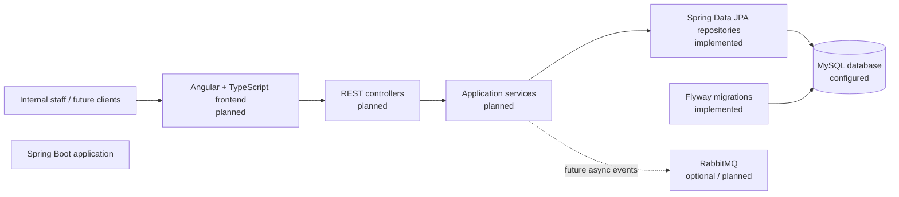
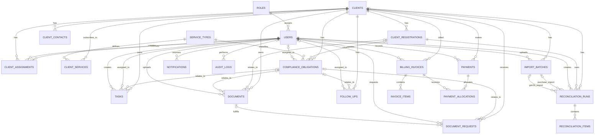

<div align="center">

# GSTHub
### GST Practice Management System

**A Java and Spring Boot backend foundation for organizing GST practice operations, client records, compliance workflows, reconciliation, and billing.**

[](https://www.oracle.com/java/technologies/javase/jdk17-archive-downloads.html)
[](https://spring.io/projects/spring-boot)
[](https://www.mysql.com/)
[](https://flywaydb.org/)
[](#project-status)

</div>

<a id="project-status"></a>

> [!WARNING]
> **GSTHub is an in-development backend foundation, not a production-ready application.** The current repository includes Spring Boot setup, JPA entities, Spring Data repositories, a MySQL/Flyway schema, and repository tests. REST controllers, application services, authentication flows, a frontend, and deployment infrastructure are not yet present.

## Table of Contents

- [1. Project Title and Overview](#1-project-title-and-overview)
- [2. Project Banner](#2-project-banner)
- [3. Key Features](#3-key-features)
- [4. Business Problem](#4-business-problem)
- [5. Solution](#5-solution)
- [6. Technology Stack](#6-technology-stack)
- [7. System Architecture](#7-system-architecture)
- [8. Application Modules](#8-application-modules)
- [9. Database Design](#9-database-design)
- [10. Entity Relationship Diagram](#10-entity-relationship-diagram)
- [11. Project Structure](#11-project-structure)
- [12. API Documentation](#12-api-documentation)
- [13. Installation and Setup](#13-installation-and-setup)
- [14. Database Configuration](#14-database-configuration)
- [15. Running the Application](#15-running-the-application)
- [16. Environment Variables](#16-environment-variables)
- [17. Testing](#17-testing)
- [18. Security Considerations](#18-security-considerations)
- [19. Screenshots](#19-screenshots)
- [20. Future Enhancements](#20-future-enhancements)
- [21. Contribution Guidelines](#21-contribution-guidelines)
- [22. Author](#22-author)
- [23. License](#23-license)

## 1. Project Title and Overview

**GSTHub – GST Practice Management System** is a Java backend project for a future web application serving GST consultants, chartered accountants, tax professionals, accounting firms, and internal office staff.

The goal is to bring client records, GST registrations, compliance obligations, staff work, documents, reconciliation, and billing into one system instead of relying on disconnected spreadsheets and follow-up messages. The planned initial operating scope is approximately **200–500 clients and six internal users**; this is a target, not a measured capacity claim.

The application is currently at the **domain and persistence foundation** stage. The project name is GSTHub. Some existing database identifiers and migration filenames retain the earlier `gstflow` naming; these are implementation identifiers, not the current product name.

## 2. Project Banner

No separate banner image or logo is committed. The title and badges at the top of this README serve as the project header.

## 3. Key Features

### Implemented in the repository

- JPA entity model for clients, contacts, registrations, users, roles, service types, assignments, compliance obligations, tasks, documents, follow-ups, reconciliation, invoices, payments, notifications, and audit records
- Spring Data JPA repositories for domain persistence
- Repository queries covering client and GSTIN lookup, assigned tasks, overdue obligations, and unread notifications
- Pagination support in applicable repository methods
- MySQL schema defined by a Flyway migration
- Hibernate schema validation configuration
- H2-backed repository tests
- Spring Actuator, Spring Security, validation, and Spring Web MVC dependencies
- Maven Wrapper scripts for Windows and Unix-like environments

These are persistence and dependency-level capabilities. They do **not** imply that complete user-facing workflows, REST endpoints, authentication, or notification delivery are available.

### In development / next implementation layers

- REST API controllers and application services
- Authentication and user login
- Enforced role-based authorization
- Complete client and staff management workflows
- Compliance operations and user interfaces
- Document upload and storage implementation
- Billing and reconciliation workflows
- Dashboard and reporting
- Notification delivery
- Frontend application

### Planned product capabilities

- Automated GSTR-1 and GSTR-3B workflows
- ITC and GSTR-2B reconciliation processing and reporting
- Dedicated ITR, TDS, e-way bill, and e-invoice tracking
- Follow-up automation
- PDF reports and invoices
- Authorized GST portal or GSP integration
- Client self-service and WhatsApp/email integrations

## 4. Business Problem

Tax practices may manage client details in spreadsheets, distribute work through messages, and track deadlines in separate files. Disconnected tools make it harder to identify overdue work, balance staff assignments, keep a reliable client history, manage supporting documents, reconcile purchase data, and track invoices and collections.

## 5. Solution

GSTHub is being developed as a centralized practice-management system. The current backend models core domain relationships and provides repository-level persistence. The intended workflows are organized around:

1. Client records and multiple GST registrations
2. Services and staff assignments
3. Compliance obligations and tasks
4. Document records and requests
5. Follow-ups and notifications
6. Import batches and reconciliation runs
7. Invoices, payments, and allocations
8. Audit records and future reporting

The project is intended to remain a **modular monolith**: a single application organized into cohesive business domains, not a microservices system.

## 6. Technology Stack

This section separates the stack verified in the repository from technologies intended for the planned application. Planned items are not installed or configured unless noted otherwise.

### Implemented / configured

| Area | Technology | Current evidence/status |
|---|---|---|
| Main language | Java 17 | `pom.xml` compiler property |
| Backend framework | Spring Boot 4.2.0 | Maven parent version |
| Web layer dependency | Spring Web MVC | Starter dependency; no controllers currently present |
| Persistence | Spring Data JPA and Hibernate | JPA entities and repositories |
| Database | MySQL | JDBC driver and datasource configuration |
| Schema migrations | Flyway | Starter, MySQL module, and migration `V1__create_gstflow_tables.sql` |
| Security framework | Spring Security | Dependency only; no application security configuration or login flow |
| Validation | Spring Boot validation / Jakarta validation | Starter dependency |
| Operations | Spring Boot Actuator | Dependency configured; exposed endpoints are not documented/configured here |
| Boilerplate reduction | Lombok | Maven dependency and annotation processing |
| Build | Apache Maven and Maven Wrapper | `pom.xml`, `mvnw`, `mvnw.cmd` |
| Test framework | JUnit 5 and Spring Boot test starters | Test dependencies and test classes |
| Test database | H2 | Test-scope Maven dependency |
| Source hosting/version control | Git and GitHub | Repository hosted on GitHub |

### Planned application stack (not yet implemented/configured)

| Area | Intended technology | Status |
|---|---|---|
| Frontend language | TypeScript | Planned with Angular; no frontend project in this repository |
| Frontend framework | Angular | Planned; no `package.json` or Angular workspace is present |
| Asynchronous messaging | RabbitMQ | Optional/planned; no dependency or broker configuration is present |
| API specification | Swagger / OpenAPI | Planned; no OpenAPI dependency or specification is present |
| Containerization | Docker / Docker Compose | Planned; no Docker configuration is present |
| Mocking | Mockito | Not explicitly included/configured in the current Maven dependencies |
| Authentication | JWT or secure session-based authentication | Not selected or implemented; decide before building auth workflows |
| Deployment platform | To be selected | No cloud provider, hosting platform, or deployment pipeline is configured |
| External channels | Email, WhatsApp Business, GST portal/GSP | Product ideas only; no integrations are configured |

**Platforms currently evidenced:** Java/Spring Boot backend, MySQL database, Maven builds, GitHub source hosting, and Windows-friendly wrapper scripts. Windows 10/11 is the documented local-development path. No production hosting platform has been selected.

## 7. System Architecture

The current codebase is a backend foundation for a planned **modular monolith**. The Angular client, HTTP controllers, service layer, message broker, and deployment platform shown as planned are not yet implemented. Spring Data repositories, JPA entities, MySQL configuration, and Flyway migrations are present.



`GstHubApplication` is the Spring Boot entry point. The controller and service layers in the diagram describe the intended architecture, not current repository features. RabbitMQ is not required by the current application and should only be introduced if asynchronous processing is needed.

## 8. Application Modules

“Domain foundation” means entities, schema, and/or repositories exist; it does not mean a complete workflow or user interface is implemented.

| Module | Status | Repository evidence / notes |
|---|---|---|
| Client Management | Domain foundation implemented | Client/contact entities and client repository |
| Multiple GST Registrations | Domain foundation implemented | Client registration entity and GSTIN lookup repository |
| Staff and User Management | Domain foundation implemented | User and role entities/repositories; no complete user workflows |
| Role-Based Access Control | Planned | Role entity and Spring Security dependency exist; enforcement is absent |
| GST Compliance Tracking | Domain foundation implemented | Compliance obligation entity and repository queries |
| GSTR-1 and GSTR-3B tracking | Planned | Service types can represent services; no dedicated filing workflow |
| ITC Reconciliation | Domain foundation implemented | Import batch, reconciliation run, and reconciliation item model |
| GST Registration Management | Domain foundation implemented | Client registration entity and repository |
| ITR and TDS Tracking | Planned | No dedicated entities or workflows verified |
| E-way Bill and E-invoice Tracking | Planned | No dedicated entities or workflows verified |
| Task Management | Domain foundation implemented | Task entity and assigned-task query |
| Client Follow-ups | Domain foundation implemented | Follow-up entity and repository |
| Document Management | Domain foundation implemented | Document and document request entities/repositories; file handling not implemented |
| Invoice and Billing Management | Domain foundation implemented | Invoice and invoice-item entities/repositories |
| Payment Tracking | Domain foundation implemented | Payment and allocation entities/repositories |
| Dashboard and Reports | Planned | No reporting/controller implementation verified |
| Audit Logging | Domain foundation implemented | Audit log schema/entity; recording service is not implemented |
| Notifications | Domain foundation implemented | Notification model and unread query; delivery is not implemented |

## 9. Database Design

The migration `src/main/resources/db/migration/V1__create_gstflow_tables.sql` defines the current relational schema. Hibernate uses `ddl-auto=validate`, so JPA mappings are expected to match the schema. `gstflow_db` is the configured local database name and retains the earlier naming convention.

### Tables in the migration

- **Identity and configuration:** `roles`, `users`, `service_types`
- **Client operations:** `clients`, `client_contacts`, `client_registrations`, `client_services`, `client_assignments`
- **Compliance and work management:** `compliance_obligations`, `tasks`, `follow_ups`, `documents`, `document_requests`
- **Imports and reconciliation:** `import_batches`, `reconciliation_runs`, `reconciliation_items`
- **Billing:** `billing_invoices`, `invoice_items`, `payments`, `payment_allocations`
- **Cross-cutting records:** `notifications`, `audit_logs`

The migration defines foreign-key relationships including roles to users; clients to contacts, registrations, services, assignments, obligations, tasks, documents, follow-ups, reconciliation runs, invoices, and payments; users to assignments and work records; service types to client services and compliance obligations; reconciliation runs to registrations/import batches/items; and payments to invoice allocations.

## 10. Entity Relationship Diagram

The following diagram reflects foreign keys defined by the current Flyway migration.



## 11. Project Structure

```text
GSTHub/
├── .mvn/wrapper/                  # Maven Wrapper configuration
├── src/
│   ├── main/
│   │   ├── java/com/example/GSTHub/
│   │   │   ├── GstHubApplication.java
│   │   │   ├── Model/             # JPA domain entities
│   │   │   └── Repository/        # Spring Data JPA repositories
│   │   └── resources/
│   │       ├── application.properties
│   │       └── db/migration/
│   │           └── V1__create_gstflow_tables.sql
│   └── test/java/com/example/GSTHub/
│       ├── GstHubApplicationTests.java
│       └── repository/RepositoryLayerTest.java
├── mvnw
├── mvnw.cmd
├── pom.xml
├── LICENSE
└── README.md
```

## 12. API Documentation

**There are currently no REST controllers or HTTP endpoint mappings in the repository.** Consequently, there are no implemented API endpoints to document and no Swagger/OpenAPI specification.

The following API areas are candidates for future implementation; these are not existing routes:

| API area | Intended responsibility | Status |
|---|---|---|
| Authentication | Login and session/token lifecycle | Planned |
| Users | Staff management | Planned |
| Clients | Client management and search | Planned |
| Registrations | GST registration records | Planned |
| Tasks | Assignment and task lifecycle | Planned |
| Compliance | Obligation and filing status | Planned |
| Documents | Document requests and secure file handling | Planned |
| Follow-ups | Scheduling and outcomes | Planned |
| Reconciliation | Imports and reconciliation runs | Planned |
| Billing | Invoices, payments, and allocations | Planned |
| Reports | Dashboard and management reporting | Planned |

## 13. Installation and Setup

### Prerequisites

- Windows 10/11 or another Java-supported development environment
- Java Development Kit (JDK) 17
- Git
- MySQL Server (MySQL 8.x is a suggested local setup; verify compatibility with your chosen server)
- Maven installed locally **or** use the included Maven Wrapper
- Optional IDE: IntelliJ IDEA or Visual Studio Code

### 1. Install Java

Install a JDK 17 distribution and confirm it is on `PATH`:

```powershell
java -version
```

Set `JAVA_HOME` to the JDK installation directory and add `%JAVA_HOME%\bin` to `PATH` if needed.

### 2. Clone the repository

```powershell
git clone https://github.com/Thushar7/GSTHub.git
cd GSTHub
git switch master
```

### 3. Create the local database

Start MySQL Server, then create the database through MySQL Workbench or the MySQL CLI:

```sql
CREATE DATABASE gstflow_db
  CHARACTER SET utf8mb4
  COLLATE utf8mb4_unicode_ci;
```

### 4. Configure database access

The current `application.properties` contains local datasource settings. Before running the app, configure the JDBC URL, username, and password for your own MySQL instance. Do not commit real credentials. Environment variable placeholders are shown in the configuration section, but the application does not currently bind all settings to environment variables automatically; update the configuration or add Spring property placeholders as a separate implementation change.

### 5. Build and test

Windows:

```powershell
.\mvnw.cmd clean test
```

Or, with Maven installed:

```powershell
mvn clean test
```

Compile without running tests:

```powershell
.\mvnw.cmd clean compile
```

### 6. Frontend setup

There is no Angular or other frontend project in the repository yet, so there are currently no npm installation or frontend run commands.

## 14. Database Configuration

The checked-in `src/main/resources/application.properties` configures:

- Application name: `GSTHub`
- Server port: `8080`
- MySQL database: `gstflow_db` on localhost
- Hibernate DDL mode: `validate`
- Flyway migrations: enabled
- SQL logging: enabled

The application database user must have permission to access the database and create/alter schema objects needed by Flyway. Flyway applies `V1__create_gstflow_tables.sql` on startup.

For safer configuration, the intended values can be externalized using Spring placeholders such as:

```properties
spring.datasource.url=${DB_URL:jdbc:mysql://localhost:3306/gstflow_db}
spring.datasource.username=${DB_USERNAME}
spring.datasource.password=${DB_PASSWORD}
```

This is an example of a recommended configuration pattern, not a claim that those placeholders are already present in the committed properties file. Never publish actual passwords, tokens, private keys, or customer data.

## 15. Running the Application

After MySQL is running and database configuration is set, start the backend from the repository root:

```powershell
.\mvnw.cmd spring-boot:run
```

Or build and launch the JAR:

```powershell
.\mvnw.cmd clean package
java -jar target\GSTHub-0.0.1-SNAPSHOT.jar
```

The configured server port is `8080` (`http://localhost:8080`). No business REST endpoints or frontend UI are currently available to browse.

## 16. Environment Variables

No complete application-specific environment-variable binding is currently implemented. These are recommended configuration names for future externalization:

| Variable | Purpose | Status |
|---|---|---|
| `DB_URL` | MySQL JDBC URL | Suggested; add Spring placeholder binding |
| `DB_USERNAME` | MySQL username | Suggested; add Spring placeholder binding |
| `DB_PASSWORD` | MySQL password | Suggested; add Spring placeholder binding |
| `JWT_SECRET` | Authentication signing secret | Future only; JWT is not implemented |
| `FILE_STORAGE_ROOT` | Secure document storage location | Future only; upload/storage is not implemented |
| `RABBITMQ_HOST` | Message broker host | Future only; RabbitMQ is not configured |

Never commit secrets to source control. Use local environment variables or a suitable secrets manager once those settings are bound by the application.

## 17. Testing

The repository contains:

- `GstHubApplicationTests` — Spring application context test
- `RepositoryLayerTest` — H2-backed repository tests covering user email, client code, GSTIN lookup, assigned tasks, overdue obligations, and unread notifications

Run tests with:

```powershell
.\mvnw.cmd test
```

Service unit tests, controller/API integration tests, authorization tests, MySQL/Flyway integration tests, and end-to-end workflows remain future coverage. Mockito is not explicitly configured in the current `pom.xml`.

## 18. Security Considerations

### Present in the codebase

- Spring Security dependency is included, but it is not configured as an application authentication or authorization system.
- The user schema has a `password_hash` column; no password hashing flow is implemented.
- A user-to-role relationship is present in the schema and model; role enforcement is not implemented.
- Audit log entity/schema exist; application-level audit event recording is not implemented.

### Required before production use

- Implement authentication and secure password hashing (for example, BCrypt)
- Enforce authorization in request and service layers
- Externalize database credentials and all other secrets
- Implement secure document storage, access controls, and upload validation
- Configure HTTPS/TLS, CSRF protections, and secure deployment settings appropriate to the chosen client/auth model
- Add audit event recording and operational monitoring
- Review privacy, retention, backup, and recovery requirements for customer data

Until these controls and complete workflows are implemented and reviewed, do not expose the application to untrusted networks or use it for production/customer data.

## 19. Screenshots

No screenshots are available because the frontend has not been committed. Add real screenshots here when the UI exists:

```markdown


```

## 20. Future Enhancements

All items below are planned unless implemented and verified in a future change:

- Angular + TypeScript staff-facing web frontend
- Client self-service portal
- Authentication, authorization, and role enforcement
- Automated recurring compliance obligation generation
- GSTR-1/GSTR-3B workflows and advanced ITC/GSTR-2B reconciliation reports
- Dedicated ITR, TDS, e-way bill, and e-invoice tracking
- Secure document storage with malware checks and controlled access
- Email reminders and WhatsApp Business integration
- Authorized GST portal/GSP integrations
- PDF reports and invoices
- OpenAPI/Swagger documentation
- RabbitMQ for asynchronous workloads if justified by product needs
- Docker and Docker Compose for repeatable development/deployment
- Select a cloud/hosting platform; implement deployment, backups, and monitoring
- Broader unit, integration, security, and end-to-end test coverage

## 21. Contribution Guidelines

Contributions should follow a focused, migration-safe workflow:

1. Fork the repository and create a feature branch from `master`.
2. Keep changes consistent with the existing Java package and entity conventions.
3. Add or update Flyway migrations for schema changes; do not rely on ad-hoc production SQL.
4. Keep JPA mappings aligned with migration constraints and Hibernate validation.
5. Add JUnit tests for new behavior and update repository documentation when architecture or configuration changes.
6. Do not commit passwords, API keys, JWT secrets, customer data, or other sensitive material.
7. Open a pull request describing the change, test evidence, and migration impact.

## 22. Author

**Thushar**  
GitHub: [@Thushar7](https://github.com/Thushar7)

## 23. License

This repository includes an **All Rights Reserved** license. Use, copying, modification, distribution, publication, sublicensing, and sale are prohibited without prior written permission from the copyright holder. See [`LICENSE`](LICENSE) for the full terms.
